  
  
  

**Full-stack developer** with a B.Tech in Computer Science and Engineering. This is where I learn and experiment: deep-learning notebooks, Spring Boot backends, PHP storefronts and portals, going back to my college days in 2018. My work on AI-assisted software delivery lives on my main account, **[@AlanLands](https://github.com/AlanLands)**.

- **Deep learning for medical imaging**: blindness detection from diabetic retinopathy scans, trained on the APTOS 2019 and 2015 Kaggle datasets
- **Transfer learning**: dog-breed classification with fastai ResNet50/101, Inception-v3 and Inception-ResNet-v2
- **AI for application maintenance**: a six-scenario tabletop demo on a synthetic insurer
- **Web and backend**: Spring Boot, PHP/MySQL storefronts with admin panels, HTML/CSS/JS front ends

### 🧠 Deep learning

| Project | What it does | Tech | Highlights |
|---------|--------------|------|------------|
| **[OPTICA](https://github.com/Alanlands1/OPTICA)** | Blindness detection from diabetic retinopathy images, with a Flask web app for uploading a scan and getting a prediction | Jupyter, ResNet, DenseNet, Flask | APTOS 2019 and 2015 datasets Trained weights published on Kaggle Deployable with one `main.py` |
| **[Dog_Breed_Identification](https://github.com/Alanlands1/Dog_Breed_Identification)** | Fine-grained image classification of dog breeds using pre-trained CNNs as feature extractors | fastai, PyTorch, Inception-v3, Inception-ResNet-v2, ResNet50/101 | Four architectures compared Best validation multiclass loss 0.347 (ResNet101) Kaggle dataset |
| **[DOG-BREED-IDENTIFICATION](https://github.com/Alanlands1/DOG-BREED-IDENTIFICATION)** | Fork of the above with an added RAG tutorial notebook | Jupyter, RAG | Retrieval-augmented generation walkthrough |

### 🤖 AI for application maintenance

| Project | What it does | Tech | Highlights |
|---------|--------------|------|------------|
| **[sixFold](https://github.com/Alanlands1/sixFold)** | AMS tabletop demo: six AI-driven scenarios (S1 to S6) covering incident triage, RCA, enhancement delivery, knowledge and onboarding, predictive ops and governance reporting, on a synthetic MapleSure Insurance app | Python, Streamlit, FastAPI, Anthropic & OpenAI SDKs, scikit-learn, GitLab and ServiceNow clients | One module per scenario Seeded synthetic data generators Per-scenario run/reset scripts and presenter notes |

### ⚙️ Web & backend

| Project | What it does | Tech |
|---------|--------------|------|
| **[SpringBoot-Alan](https://github.com/Alanlands1/SpringBoot-Alan)** | Spring Boot practice project with the Maven wrapper | Java, Spring Boot, Maven |
| **[springboot](https://github.com/Alanlands1/springboot)** | Login and signup pages for a Spring Boot app | HTML, CSS, JavaScript |
| **PJM Store** (private) | E-commerce storefront with admin panel, API and mobile header | PHP, JavaScript, MySQL |
| **PJS Collections** (private) | Web app with an AdminLTE admin panel and database migrations | PHP, Composer, AdminLTE |
| **[UniMedic-VarDev](https://github.com/Alanlands1/UniMedic-VarDev)** | Hospital, doctor and lab portals, a VarDev Solutions college project | PHP, SCSS |
| **[FullScreenVerticalSlider](https://github.com/Alanlands1/FullScreenVerticalSlider)** | Full-screen vertical slider template for college festivals | HTML, SCSS, JavaScript |
| **[project-onlineshopping](https://github.com/Alanlands1/project-onlineshopping)** | Online shopping website with PHPMailer, my first repo (2018) | PHP, CSS |

> _Enterprise and AI-assisted delivery work lives on my main account: [github.com/AlanLands](https://github.com/AlanLands)_

  
  

**Tata Consultancy Services** · Kochi, India
- Application maintenance and delivery for enterprise applications

**B.Tech, Computer Science and Engineering**

AI-assisted software delivery, AMS demos and insurance apps: **[@AlanLands](https://github.com/AlanLands)**

**YouTube:** [youtube.com/c/Alanlands](https://www.youtube.com/c/Alanlands)
**Kaggle:** [kaggle.com/alanlands23](https://www.kaggle.com/alanlands23)
**GitHub:** [@Alanlands1](https://github.com/Alanlands1) · [@AlanLands](https://github.com/AlanLands)

---

